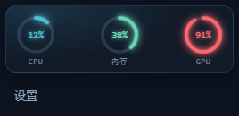

# dsh-pc-monitor

Live **CPU / memory / GPU** gauges for the [DeepSeek Harness](https://github.com/deepseek-ai) web UI: a compact card pinned above the sidebar's Settings row, one ring per metric, percentage inside and a neon progress arc outside.



- One ring per metric, full circle = 100 %, number inside.
- Refreshes every 2 s, pauses while the page is hidden.
- Colour follows load: blue → mint → amber → coral red, interpolated in sRGB.
- Card background, border and labels use the DSH theme tokens, so it follows light/dark themes.
- Mounted on `document.body` (fixed, anchored to the Settings row once a second) instead of inside the React sidebar tree — this is what keeps the pointer cursor from flickering when the sidebar re-renders.
- A metric it cannot read shows `--`; nothing is faked.

**Windows only.** CPU and memory are read in the Host process; GPU needs performance counters through a resident PowerShell sampler, which is Windows-specific.

## Install

From the DSH plugin market, or:

```sh
dsh plugin add dsh-pc-monitor
```

Inside a running DSH session the same thing is `plugin_manager install_bundle "dsh-pc-monitor"`. Restart DSH afterwards — bundles are loaded at process start.

## Metrics

| Metric | Source | Notes |
|---|---|---|
| CPU | `os.cpus()` delta in the Host process | no child process |
| Memory | `\Memory\Available MBytes` from the sampler, falling back to `os.freemem()` | Windows `os.freemem()` ignores the standby list and overstates usage |
| GPU | `GPU Engine` performance counters | every process × engine instance is merged into its physical engine; the busiest engine's utilisation is shown |

There is **no temperature ring**. The only temperature a Windows process can read without a kernel driver is the ACPI thermal zone, and on the test machine (HP EliteBook 630 G10, i7-1355U) it is a coarse chassis value — 34.2 °C idle, 34.7 °C at 64 % CPU load. Real core temperature needs LibreHardwareMonitor or HWiNFO with their kernel driver and administrator rights, so the ring is left out rather than showing a misleading number.

### Why a resident PowerShell process

`Get-Counter` fails outright when a single one of the ~325 GPU engine instances is invalid, and those instances come and go with every process — a one-shot call is unreliable and takes several seconds. `perf.ps1` opens one PDH query, adds every engine counter once, then only collects and reads it each tick, skipping the counters that went stale. Steady-state cost is about 2.5 % of one core at a 2 s cadence.

## Configuration

Colours live in one place: `COLOR_STOPS` at the top of `client.js` — a `[percent, colour]` list interpolated in sRGB. Interpolating HSL hue instead walks through fluorescent greens on the way from blue to amber, which is why it is not used here.

## Troubleshooting

- Every ring shows `--`: the page cannot reach the Host. Check `GET /api/dsh-pc-monitor/snapshot`; it only answers loopback requests.
- Only GPU shows `--`: the sampler is not running. The snapshot reports `sample.ageMs` (stale after 8 s) and the child's `stderr`.
- Card is missing: the sidebar is narrower than 168 px, or no Settings row was found. Widen the sidebar.

## Layout

```
index.js          Host half: sampling, /api/dsh-pc-monitor/snapshot (loopback only)
client.js         browser half: body-level mount, theme tokens, ring rendering
perf.ps1          resident sampler, one JSON object per line on stdout
cordis.patch.yml  bundle patch inserting the pc-monitor row
icon.svg          icon
```

## Uninstall

```sh
dsh plugin remove dsh-pc-monitor
```

## License

MIT — see [LICENSE](LICENSE).

---

## 中文

在 DeepSeek Harness 的 Web 侧边栏底部（Settings 行上方）常驻一张三环监测卡片：CPU 占用、内存占用、GPU 占用。内圈是百分比，外圈是进度环，整圈 100 %；每 2 秒刷新，页面不可见时暂停。

- 配色由占用率决定：蓝 → 薄荷绿 → 琥珀 → 珊瑚红（D 方案，色值取自 [LolColors](https://webdesignrankings.com/resources/lolcolors/) 的 `#47B8E0 / #5BD6C0 / #FFC952 / #FF7473 / #E8455F`），在 sRGB 里分段线性插值。
- 卡片挂在 `document.body` 上并用主题 token 着色，随明暗主题切换；不插进 React 的侧边栏子树，所以鼠标指针不会在箭头和手形之间闪。
- GPU 读不到时显示 `--`，不伪造数据。
- **没有温度环**：Windows 上免提权只能拿 ACPI 热区值，实测是粗粒度机箱温度（64 % CPU 负载下 34.2 → 34.7 °C），不是核心温度；真实核心温度需要管理员权限的内核驱动（LibreHardwareMonitor / HWiNFO），故先不显示。

安装：从插件市场一键安装，或在 DSH 里 `plugin_manager install_bundle "dsh-pc-monitor"`，装完需重启 DSH。仅支持 Windows。
